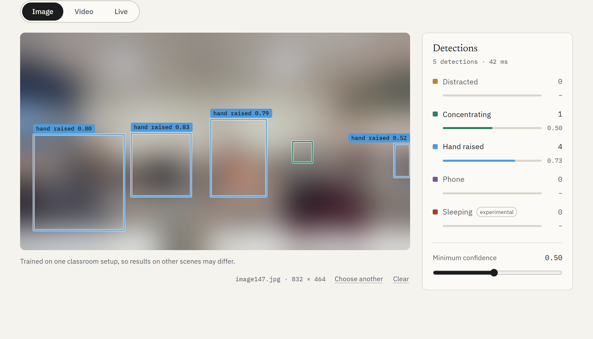
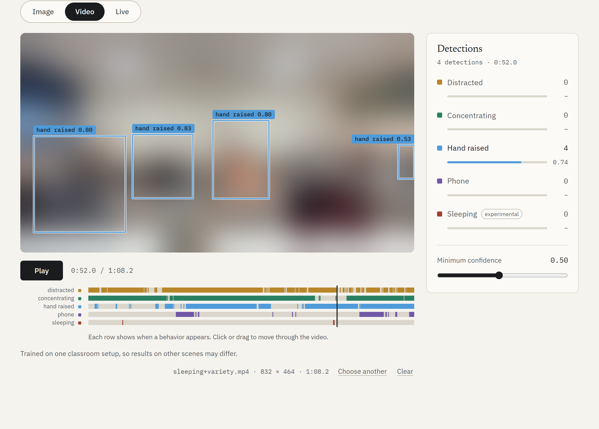
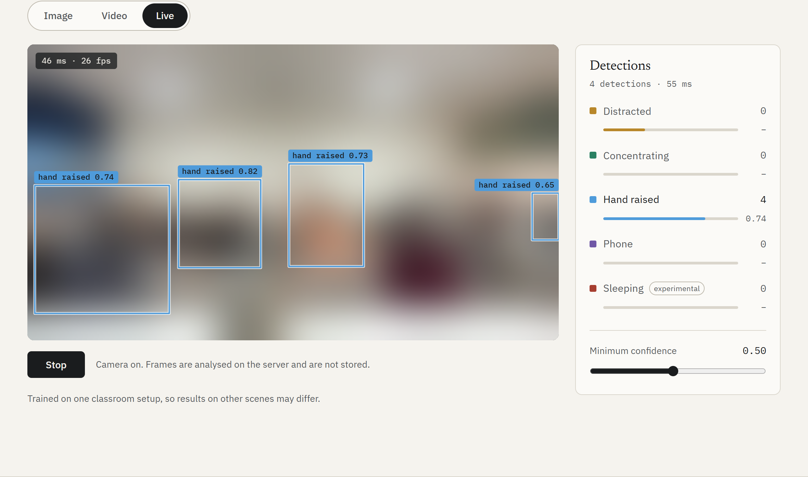
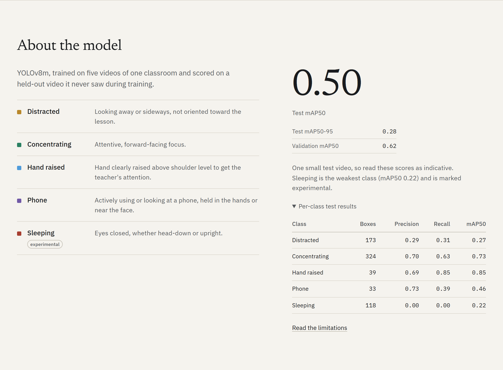

# Focal: classroom behavior detection

Focal detects five classroom behaviors (concentrating, distracted, hand raised, phone, sleeping) in images, uploaded video and a live camera. It is a YOLOv8m model fine-tuned on frames from classroom videos, served by a small FastAPI app with a plain HTML/CSS/JavaScript interface.

The project covers the whole pipeline: extracting and labelling frames, a split that keeps each source video in one split only, training and evaluation, and the web app. It also documents where the model falls short. The `sleeping` class in particular does not hold up on a held-out video, and [`docs/LIMITATIONS.md`](docs/LIMITATIONS.md) explains why.

## Results

Measured on a held-out test video that was never used for training or model selection. Each split is a single video, so the scores are noisy.

| Test video | mAP50 |
|---|---|
| All five classes | **0.502** |
| Best class (`hand_raised`) | 0.845 |
| Weakest class (`sleeping`) | 0.216 |

Validation scores, precision, recall and the full per-class tables are in [`docs/LIMITATIONS.md`](docs/LIMITATIONS.md#4-results).

## Screenshots

Faces in each screenshot are blurred to protect the people in the footage. The detection boxes, labels and interface are real.



**Image mode.** Each detection gets a class-colored box and a confidence label. The side panel summarizes counts and mean confidence per class, and the confidence slider filters in the browser without re-running the model.



**Video mode.** The server analyses the video and the browser plays the original file with the boxes synced to the playhead. The timeline under the player shows when each behavior appears, and clicking it jumps to that moment.



**Live mode.** Frames from the camera stream to the server over a WebSocket, and the detections come back and are drawn over the picture. Here a recorded classroom frame stands in for the webcam. The chip shows the round-trip latency and frame rate, about 47 ms and 29 fps on the development laptop (RTX 4060).



**Model information.** The class definitions and an evaluation summary, including the per-class results. The weakest class is named on the page and marked experimental.

## Quick start

```powershell
python -m venv venv
venv\Scripts\Activate.ps1          # macOS/Linux: source venv/bin/activate
pip install -r requirements.txt
git lfs pull                       # fetches models/best.pt
uvicorn app.server.main:app --port 8000
```

Then open <http://127.0.0.1:8000>. [`app/README.md`](app/README.md) has the details: requirements, configuration, the API and browser support.

To run the tests, install the dev requirements and run pytest: `pip install -r requirements-dev.txt` then `python -m pytest app/tests`.

## Data

The training frames (about 430) and the five source videos show real students, so they are **not included** in this repository. What is included: the YOLO label files in `data/dataset/labels/`, `classes.txt`, `data.yaml`, the frame-to-video mapping `data/raw_frames/frame_mapping.txt`, and the trained weights. The earlier project reports are not included either. To retrain, supply your own labelled frames in YOLO format under `data/dataset/`, plus a `frame_mapping.txt` that maps each frame to its source video (the split is made by video); see [`scripts/prepare_dataset.py`](scripts/prepare_dataset.py). The app itself needs only `models/best.pt`.

## License

The code is released under the [MIT License](LICENSE). `models/best.pt` was trained on private classroom footage, so don't assume it can be redistributed on the same terms; see [Data and model usage](docs/LIMITATIONS.md#7-data-and-model-usage).

## How it was built

1. [`extract-images.py`](extract-images.py) samples one frame per second from each source video (the videos are not part of this repository).
2. The frames were labelled by hand in YOLO format, following a written annotation guide (in French; not included in this repository).
3. [`scripts/prepare_dataset.py`](scripts/prepare_dataset.py) splits whole videos into train, validation and test, so near-identical frames from one video never land in different splits. It balances classes by augmenting the training split only.
4. [`scripts/train.py`](scripts/train.py) trains YOLOv8m, evaluates on the validation and test videos, and writes `models/best.pt` and `results/metrics_summary.json`.
5. [`app/`](app/) serves the model.

## Results and limitations

The model is trained on five videos of a single classroom, so the evaluation is one held-out video per split and the scores are noisy. [`docs/LIMITATIONS.md`](docs/LIMITATIONS.md) has the full results, the split rationale, the analysis of the `sleeping` class, and why the numbers are not comparable to those of the original notebook. The app serves the same document at `/limitations`.

## Repository layout

```
app/          web app: FastAPI server, static frontend, tests
data/         dataset/ (labels, classes.txt, data.yaml; no images), raw_frames/ (frame-to-video mapping only)
docs/         LIMITATIONS.md, screenshots/ (faces blurred)
models/       best.pt (Git LFS)
notebooks/    the original Colab notebook, superseded by scripts/
results/      metrics_summary.json from the latest training run
scripts/      prepare_dataset.py, train.py
extras/       a small interactive explainer for the augmentation step
```
